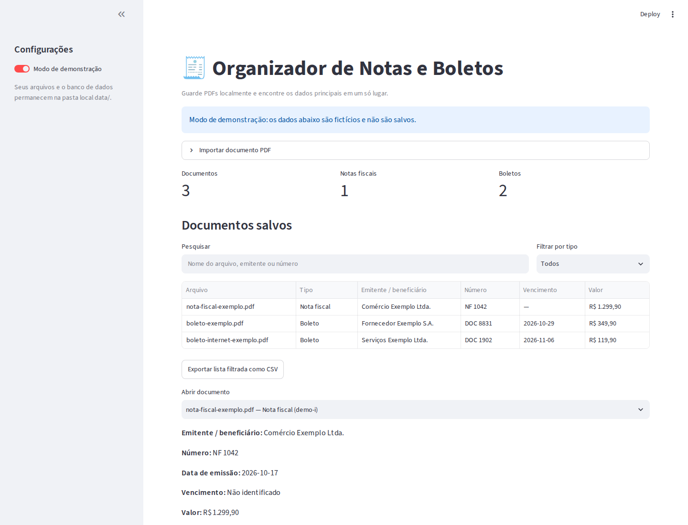
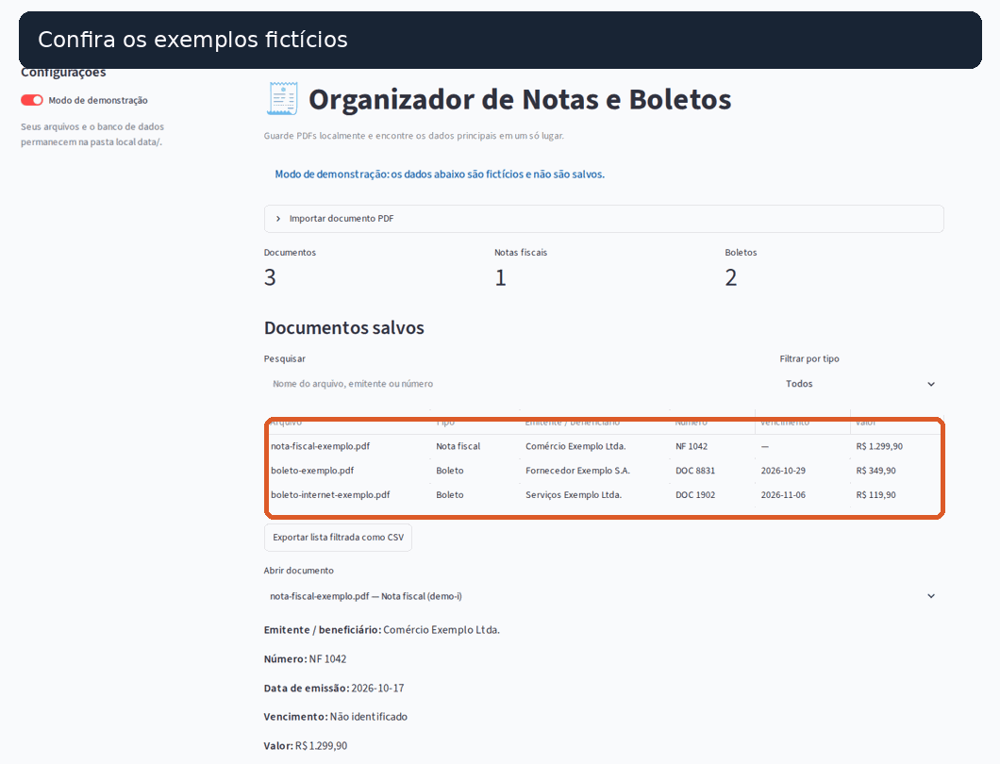

# Organizador de Notas e Boletos

Aplicação local para guardar notas fiscais e boletos em PDF, extrair alguns campos automaticamente e encontrar documentos sem abrir cada arquivo manualmente. Projeto de portfólio com foco em Python, Streamlit, SQLite, leitura de PDF e processamento local de arquivos.

> A extração é heurística, não substitui conferência humana e pode variar conforme o layout. OCR local é opcional e também pode interpretar campos incorretamente.

## O que já faz

- Importa PDFs de até 15 MB e identifica notas fiscais e boletos por conteúdo.
- Extrai campos comuns, como emitente/beneficiário, número, datas e valor.
- Guarda os arquivos e os dados em SQLite na máquina local.
- Evita importar o mesmo arquivo duas vezes usando seu hash SHA-256.
- Pesquisa e filtra documentos e permite baixar o PDF original ou exportar a lista como CSV.
- Permite corrigir campos extraídos e excluir documentos importados.
- Oferece modo de demonstração com dados fictícios, sem tocar nos documentos locais.
- Faz OCR local opcional de documentos digitalizados, quando as dependências adicionais estão instaladas.

Os campos extraídos são uma conveniência e podem estar ausentes ou incorretos conforme o formato do PDF. Confira o documento original antes de usar os dados em pagamentos ou registros contábeis.

## Demonstração

O **Modo de demonstração** começa ativado para você explorar a interface sem arquivos reais. Desative-o na barra lateral para importar PDFs e usar seu banco de dados local. Há PDFs sintéticos disponíveis no painel e na pasta [`examples/`](examples/), incluindo um documento escaneado para exercitar o OCR.





## Requisitos

- Python 3.11 ou mais recente
- Um ambiente gráfico para abrir o dashboard Streamlit

## Instalação

```bash
git clone https://github.com/LuaKaiqueSilva/invoice-organizer.git
cd invoice-organizer
python -m venv .venv
source .venv/bin/activate
python -m pip install -r requirements.txt
```

Como alternativa, `./scripts/setup.sh` cria o ambiente virtual e instala as dependências.

No Windows PowerShell, ative o ambiente com:

```powershell
.venv\Scripts\Activate.ps1
```

## Executar

```bash
streamlit run src/main.py
```

Ou execute `./scripts/run.sh` se instalou pelo script acima.

O Streamlit mostrará um endereço local, normalmente <http://localhost:8501>. Os dados ficam em `data/` dentro do projeto. A variável `INVOICE_ORGANIZER_DATA_DIR` pode apontar para outra pasta local.

### OCR opcional para PDFs escaneados

No Ubuntu/Debian, instale o Tesseract e os dados do idioma português, depois as dependências Python opcionais:

```bash
sudo apt install tesseract-ocr tesseract-ocr-por
python -m pip install -r requirements-ocr.txt
```

O inglês é usado como idioma adicional se estiver disponível no Tesseract. O OCR roda na máquina local, aceita até 15 páginas por arquivo e não envia o PDF a serviços externos. Se o Tesseract ou as dependências não estiverem instalados, PDFs com texto selecionável continuam funcionando normalmente. O app identifica quais documentos foram lidos por OCR e exibe um aviso para conferir os campos.

Para testar: desative o modo de demonstração, baixe `example_scanned_invoice.pdf` no painel e importe-o. A extração de texto normal não exige OCR.

Na área de detalhes de um documento importado, use **Corrigir campos extraídos** para revisar os dados e a opção de exclusão com confirmação para remover o registro e o arquivo local.

## Testes

```bash
python -m pip install -r requirements-dev.txt
python -m unittest discover -v
ruff check src tests
```

## Privacidade

Os PDFs e o banco ficam na pasta local `data/`, ignorada pelo Git. O app não envia documentos a serviços externos. Evite compartilhar capturas que mostrem dados reais e mantenha uma cópia de segurança da pasta `data/` se guardar arquivos importantes.

## Decisões técnicas

- **SQLite** mantém os metadados em um único arquivo, sem exigir servidor ou conta externa; os PDFs permanecem na pasta local.
- **Extração por rótulos conhecidos** mantém o MVP leve e explicável, mas não promete compatibilidade com todo emissor.
- **OCR local opcional** preserva o funcionamento básico sem dependências de sistema e evita enviar documentos financeiros a uma API.
- **SHA-256** evita importar duas vezes exatamente o mesmo PDF; não tenta deduplicar versões diferentes do mesmo documento.
- O CSV protege células iniciadas por caracteres de fórmula para reduzir risco ao abrir em planilhas.

## Demonstração rápida

1. Abra o app e explore o modo de demonstração.
2. Desative o modo de demonstração e importe um PDF fictício da pasta `examples/`.
3. Confira os campos detectados e baixe o original.
4. Pesquise por emitente ou número e exporte a lista filtrada em CSV.

Para OCR, use `example_scanned_invoice.pdf` após instalar os componentes opcionais.

## Limitações atuais

- PDFs protegidos por senha ou sem texto selecionável não são importados.
- Não há OCR, validação fiscal, conexão bancária, envio automático de pagamentos nem classificação contábil.
- Os layouts de notas e boletos variam; a extração usa rótulos textuais conhecidos e não substitui conferência humana.

## Estrutura

```text
src/
├── config/       # caminhos e limites locais
├── dashboard/    # interface Streamlit
├── database/     # conexão e esquema SQLite
├── models/       # estruturas de documento
├── parsers/      # extração de campos a partir do texto do PDF
├── repositories/ # persistência
├── services/     # validação e importação
└── utils/        # leitura e armazenamento seguro de PDFs
```

## Licença

MIT. Consulte [LICENSE](LICENSE).
